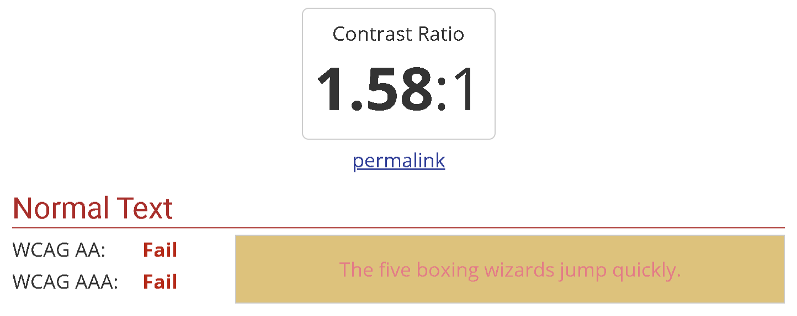
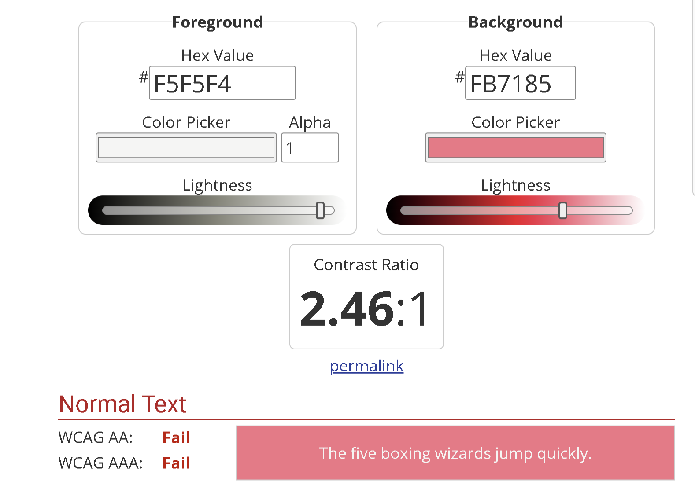
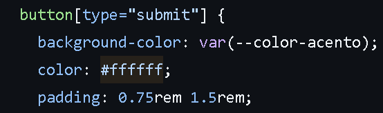

| N   | Requisito                | Ubicación                             | Hallazgo                                                                                                          | Norma que incumple | Evidencia                            | Severidad |
| --- | ------------------------ | ------------------------------------- | ----------------------------------------------------------------------------------------------------------------- | ------------------ | ------------------------------------ | --------- |
| 1   | Base 5: contraste        | estilos.css , línea 77, color #e7c270 | El contraste entre el background y el color del la letra del nav no cumple con el contraste 4.5:1 (modo oscuro)   | WCAG 2.2           |  | Alta      |
| 2   | Base 5: contraste        | estilos.css , línea 201 y 202         | El contraste entre el background del boton y el color del la letra no cumple con el contraste 4.5:1 (modo oscuro) | WCAG 2.2           | | Alta      |
| 3   | Base 5: colores en var() | estilos.css , línea 55                | Se define colores directamente, sin el uso de variables                                                           | W3C                |  | Baja      |
