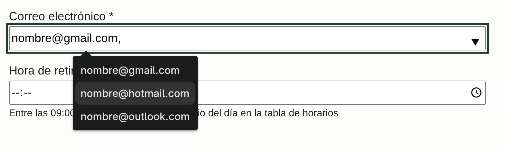
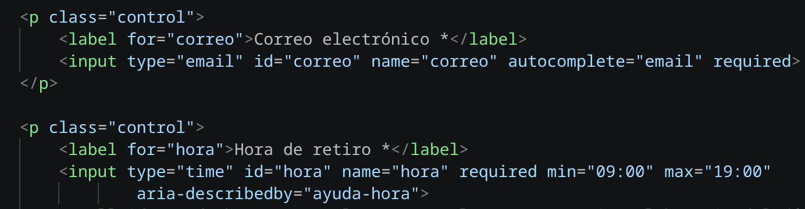
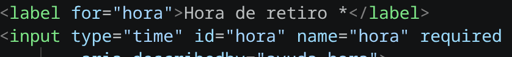
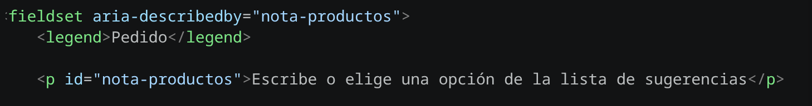

# Respuesta a los hallazgos recibidos

| N.º de hallazgo | Decisión (acepta o refuta) | Justificación con la norma | Evidencia  | Commit |
| --- | --- | --- | --- | --- |
| 1 | **Acepta** | La ficha pide «selección múltiple con `datalist`». El atributo `multiple` solo aplica a `input type="email"`, `input type="file"` y `select`. Por lo que se agregó un `datalist` en el campo de correo |  | feat(09): datalist con multiples opciones en correo |
| 2 | **Acepta** | Los controles Correo electrónico y Hora de retiro no tenían un `label` asociado: faltaba `for` y el `input` no estaba dentro del `label`. | | feat(08): atributos Aria y audotiras|
| 3 | **Acepta** | Hora de retiro mostraba `*` pero el `input` no tenía `required`.|  | feat(08): atributos Aria y audotiras |
| 4 | **Acepta** | Los tres `input` de Pedido tenían `aria-describedby="nota-productos"`, pero ese `id` no existía. |  | feat(08): atributos Aria y audotiras |

